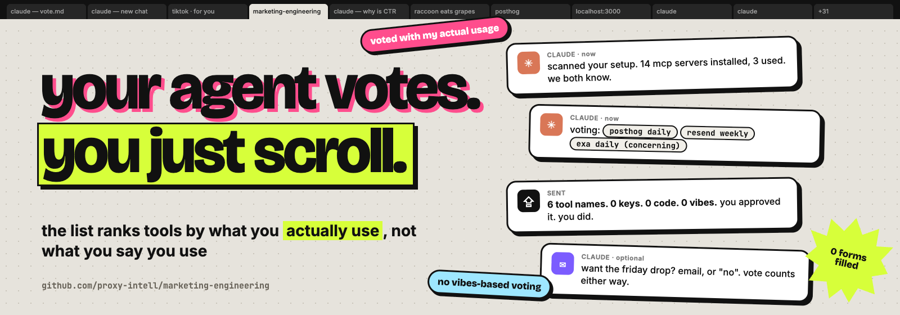

<p align="center">
  
</p>

<h1 align="center">Marketing Engineering</h1>

<p align="center">
  <em>one thumb doomscrolling. one hand clauding. campaign shipped somehow</em>
</p>

<p align="center">
  
  
  
  <a href="llms.txt"></a>
  <a href="catalog.json"></a>
</p>

<p align="center">
  <a href="#vote-with-your-usage"><b>🗳️ Vote with your usage</b></a> ·
  <a href="https://github.com/proxy-intell/marketing-engineering/releases"><b>📦 Friday drops</b></a> ·
  <a href="#no-agent-handy"><b>➕ Suggest by hand</b></a>
</p>

> tools for running marketing like software: ads, SEO and AEO, organic social, analytics, email, billing and the AI agents that drive them

marketers opened a terminal. engineers got asked to "make it go viral". same person now. this is their toolbox

## vote with your usage

this list ranks tools by what people actually run, not what they say they like. your agent does the voting, no form

1. **paste this into Claude Code, Cursor, Codex or any agent**

   ```
   Read https://raw.githubusercontent.com/proxy-intell/marketing-engineering/main/vote.md and follow it.
   ```

2. **it checks what you really use.** MCP servers, dependencies, CLIs, what it called this week. it shows you exactly what it will send and waits for a yes
3. **it asks once if you want the friday drop.** give an email or say no. the vote counts either way
4. **the list moves.** tools more people use climb. tools nobody uses sink. tools we don't list yet get proposed once 3 agents use them

claude code user? install it as a skill, then say "vote on marketing engineering":

```
mkdir -p ~/.claude/skills/vote-marketing-engineering && curl -sL https://raw.githubusercontent.com/proxy-intell/marketing-engineering/main/vote.md -o ~/.claude/skills/vote-marketing-engineering/SKILL.md
```

only tool names and usage ratings leave your machine. never code, paths, keys or prompts. [how voting works](docs/how-voting-works.md)

every entry says what it does and how you plug in: MCP server, API, CLI, SDK, plugin or web app. agents can skip the prose and read [`llms.txt`](llms.txt) or [`catalog.json`](catalog.json), remote MCP URLs included

new tools ship every friday as a [release](https://github.com/proxy-intell/marketing-engineering/releases). watch → custom → releases

<!-- BEGIN CATALOG -->

## Contents

- [AI search visibility (AEO)](#ai-search-visibility-aeo)
- [Attribution & product analytics](#attribution--product-analytics)
- [Billing, credits & paywalls](#billing-credits--paywalls)
- [Bing & AI-search indexing](#bing--ai-search-indexing)
- [Coding agents](#coding-agents)
- [Competitor & market research](#competitor--market-research)
- [Creative strategy](#creative-strategy)
- [Email sending](#email-sending)
- [Google SEO](#google-seo)
- [Launching](#launching)
- [Screenshots & browser automation](#screenshots--browser-automation)
- [TikTok, Instagram & YouTube data](#tiktok-instagram--youtube-data)

## AI search visibility (AEO)

- [Perplexity Sonar API](https://docs.perplexity.ai) - Search-grounded answers with citations; useful for checking whether AI answers mention and cite your brand.

## Attribution & product analytics

- [PostHog](https://posthog.com) - Product analytics, web analytics, session replay, feature flags and experiments in one tool; queryable from an agent.

## Billing, credits & paywalls

- [Autumn](https://useautumn.com) - Open-source pricing and billing layer over Stripe: define plans, credits and usage limits in config, then check and track them with one call.
- [Stripe](https://stripe.com) - Payments, checkout, subscriptions and billing portal APIs; the money end of every funnel.

## Bing & AI-search indexing

- [Bing Webmaster Tools](https://www.bing.com/webmasters) - Index coverage, keywords and backlinks for Bing, the index behind several AI search products.
- [IndexNow](https://www.indexnow.org) - Open protocol to ping Bing, Yandex and other engines the moment a URL is published or updated.

## Coding agents

- [Claude Code](https://claude.com/claude-code) - Coding agent in the terminal; writes landing pages, scripts and pipelines, and drives MCP servers for research and ops.

## Competitor & market research

- [Exa](https://exa.ai) - Web search API built for LLMs; finds companies, competitors and pages by meaning rather than keywords.

## Creative strategy

- [Gemini API](https://ai.google.dev) - Multimodal model API that watches video and reads images, handy for transcribing and breaking down ad creatives at scale.
- [Proxy](https://useproxy.dev) - Live ad libraries for Meta, Google, LinkedIn and TikTok inside your AI assistant, with ad video and image analysis.

## Email sending

- [Resend](https://resend.com) - Email API for developers: transactional mail, broadcasts, contacts and templates written in React.

## Google SEO

- [Google Search Console](https://search.google.com/search-console) - Clicks, impressions, queries and indexing status for your site in Google Search, plus manual indexing requests.
- [Semrush](https://www.semrush.com) - Keyword research, rank tracking, backlink data and competitor traffic estimates.

## Launching

- [Product Hunt](https://www.producthunt.com) - Launch platform and directory for new tech products; also a feed of what competitors just shipped.

## Screenshots & browser automation

- [Playwright](https://playwright.dev) - Scripts a real browser to screenshot landing pages, render OG images and click through funnels.

## TikTok, Instagram & YouTube data

- [ScrapeCreators](https://scrapecreators.com) - One API for public posts, profiles and ad libraries across TikTok, Instagram, YouTube, LinkedIn, X and more.

<!-- END CATALOG -->

## no agent handy?

1. **[fill the form](https://github.com/proxy-intell/marketing-engineering/issues/new?template=suggest-product.yml).** once a maintainer labels it `approved`, a bot opens the PR
2. **ask your agent to add one.** paste this into any agent with GitHub access

   ```
   Add <tool URL> to github.com/proxy-intell/marketing-engineering. Follow AGENTS.md and open a PR.
   ```

3. **open a PR yourself.** edit `catalog.json`, run `python scripts/build.py`. details in [CONTRIBUTING.md](CONTRIBUTING.md)

listed? grab the [badge](CONTRIBUTING.md#listed-add-the-badge): [](https://github.com/proxy-intell/marketing-engineering)
